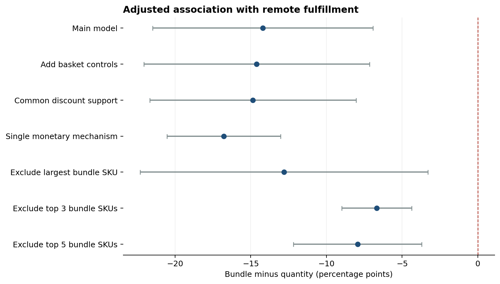

# Promotions and fulfillment at JD.com

How do bundle-dominant and quantity-dominant first-party orders differ in fulfillment outcomes?

This project reconstructs orders from March 2018 JD.com transactions and examines remote fulfillment, local inventory availability, and delivery time. Its central methodological question is whether an apparent promotion difference survives **limited product overlap and heavy concentration in a few bundle products**.

**Start with the [executed analysis notebook](notebooks/promotion_fulfillment.ipynb).** It presents the sample, support checks, adjusted comparisons, and sensitivity analysis.



## Main findings

| Finding | Evidence |
| --- | --- |
| Bundle orders have a lower adjusted remote-fulfillment rate | The main association is approximately −14.2 percentage points |
| The negative remote association survives concentration exclusions | Removing the largest one, three, or five bundle products gives approximately −12.8, −6.7, and −7.9 percentage points |
| Bundle activity is highly concentrated | The five largest primary SKUs account for about 90% of bundle orders |
| Within-product support is limited | Only 18 SKUs have at least three orders under both promotion mechanisms; this falls below the analysis's 20-SKU screening threshold |
| Delivery results are less stable | Estimates change sign after excluding heavily represented products |

These are observational associations. The analysis does not establish that assigning a bundle promotion causes a fulfillment improvement.

## Data and method

The data are described in [Shen et al., “JD.com: Transaction-Level Data for the 2020 MSOM Data Driven Research Challenge”](https://doi.org/10.1287/msom.2020.0900). The project uses order, product, delivery, inventory, and warehouse-network files. [Data instructions and definitions](data/README.md) explain acquisition and construction.

The supplied files reconstruct **486,928 orders**. The comparison includes **79,875 first-party bundle- or quantity-dominant orders**: 3,880 bundle and 75,995 quantity. Outcome availability and complete-case control requirements reduce individual model samples.

The main models adjust for discount depth and fixed effects for primary-product brand/attributes, order date, hour, and destination warehouse. Standard errors cluster by primary SKU. Sensitivity checks add basket controls, restrict discount overlap or monetary mechanisms, and remove the most common bundle products from both groups.

Binary outcomes use linear probability models and are reported in percentage points. Delivery uses `log(1 + hours)`. Absorbed fixed effects reduce computation; clustered CR1 covariance counts the full parameter rank, and p-values and 95% intervals consistently use cluster-based t inference. A numerical test compares this implementation with explicit dummy-variable OLS.

## Interpretation

Coarse product controls cannot remove all assortment selection when within-SKU overlap is sparse. The local-stockout measure is based on absence from a prior-day inventory listing; delivery measures cover observed JD Logistics packages. Missing line outcomes can understate order-level “any” outcomes. Discount and basket characteristics may also be related to promotion choice. These limitations are part of the result, rather than evidence for a causal promotion effect.

## Reproduce

Tested with Python 3.12. From this project folder:

```bash
python3 -m venv .venv
source .venv/bin/activate
python -m pip install -r requirements.txt
```

On Windows, create the environment with `py -3.12 -m venv .venv` and activate it using `.venv\Scripts\activate` in Command Prompt.

Place the five required CSVs in `data/raw/`. If using the supplied `Archive.zip`, place it there and run `python prepare_data.py` to extract only the needed files. Then:

```bash
python run_analysis.py
python -m unittest discover -s tests -v
```

The runner executes the notebook cells in order in a fresh Python process and saves outputs. It does not need a Jupyter server. Order reconstruction can take several minutes. To work interactively, open the notebook in your usual Jupyter environment with this Python environment selected, then use Run All.

## Repository map

| Location | Contents |
| --- | --- |
| `notebooks/` | One executed narrative analysis |
| `src/data.py` | Order reconstruction, input audits, validated reference joins |
| `src/models.py` | Fixed-effect absorption and clustered inference |
| `src/reporting.py` | Aggregate tables and public product labels |
| `data/` | Source instructions and variable definitions |
| `figures/` | Remote-fulfillment sensitivity figure |
| `results/` | Sample/support tables, estimates, diagnostics, input fingerprints |
| `tests/` | Numerical inference and convergence checks |

Raw data and earlier exploratory notebooks are excluded from this repository. The original research files are retained separately. See [validation notes](VALIDATION.md) for the changes made during repository preparation.
